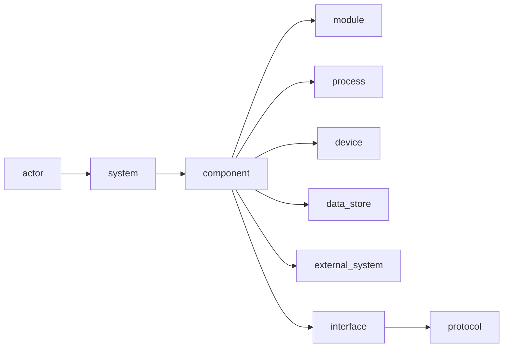
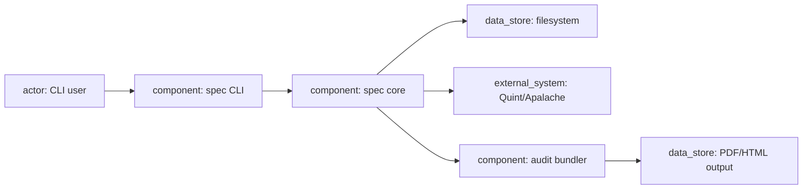

# Architecture layer

## Tool

[LikeC4](https://likec4.dev/) owns the architecture graph and the visual review surface.

It provides:

- a text DSL for systems, components, and relations;
- custom element kinds and relation kinds;
- views generated from one model;
- structural validation;
- a model API;
- an MCP server and agent skill for queries.

## Why LikeC4

- Flexible enough for non-web systems: crates, modules, processes, devices, protocols, and data stores.
- Model-based: views are projections, not hand-drawn diagrams.
- MCP support exposes the architecture to agents without scraping prose.
- Validation catches missing descriptions and invalid relations.

Structurizr is a valid alternative when strict C4 hierarchy is required. SysML v2 is an alternative when a standards-based systems model is more important than tooling ergonomics.

## Default metamodel

The framework ships a starting specification that projects may extend:

Element kinds:

- `actor`: human or external initiator;
- `system`: top-level product or service boundary;
- `subsystem`: major division inside a system;
- `component`: independently responsible unit;
- `module`: code-level unit when the project needs that level;
- `process`: executable or runtime unit;
- `device`: hardware or firmware unit;
- `data_store`: persistent data ownership;
- `external_system`: dependency outside the project boundary;
- `interface`: boundary exposed or consumed;
- `protocol`: wire or hardware protocol.

Relation kinds:

- `contains`, `depends_on`, `calls`, `reads`, `writes`, `publishes`, `subscribes`, `implements`, `deployed_on`, `connects_to`, `satisfies`, `verified_by`.

Projects may rename or add kinds, but relation endpoints and required fields must remain checkable.

## Required metadata

Every component-like element:

- `id`, `title`, `description`;
- `owner`;
- `responsibility` (one sentence);
- `boundary` (in scope and out of scope);
- `technology` or explicit `technology: none`;
- `status`;
- `provenance`.

Every relation:

- `description`;
- `status`;
- optional `contract` reference when crossing a trust boundary.

## Validation rules

Native LikeC4 validation plus `spec-lint`:

1. Every component belongs to exactly one system or parent component.
2. Every relation endpoint exists and has a legal kind pair.
3. Every component has an owner and responsibility.
4. Every external boundary has a contract reference or a waiver.
5. Every interface is exposed by exactly one component.
6. Every event has a producer and at least one consumer, or an explicit `unconsumed` waiver.
7. Every data entity has exactly one owner.
8. No component is orphaned from all entry points.
9. Dependency cycles are flagged; allowed cycles need a waiver.
10. Layering rules are configurable per project.
11. Every approved requirement references an existing component.
12. Every component satisfies at least one requirement or has a rationale waiver.

## Entry points and reachability

Each system declares entry points: CLI commands, library functions, processes, device interfaces, or external events. The linter walks relations from entry points and flags unreachable components.

This catches the common failure where a component is described but nothing uses it.

## Views for review

Minimum views:

- system context;
- component view with responsibilities;
- data ownership view;
- deployment or runtime view;
- dynamic view for each critical flow;
- boundary view showing trust and contract crossings.

Views are generated from the model. Human review uses rendered views and the generated element catalog, not the DSL.

## Agent access

The LikeC4 MCP server lets an agent:

- look up elements and relations;
- list incoming and outgoing relations;
- query nested components;
- inspect views.

Agents query the graph; they do not infer architecture from code or prose. Architecture changes still require a proposal and human approval.

## Change protocol

1. Human states a direction.
2. Agent drafts a LikeC4 change in a proposal branch.
3. `likec4 validate` and `spec-lint` run.
4. The change report shows affected components, relations, requirements, and views.
5. Human reviews rendered before/after views.
6. Approval updates `spec.lock`.

An agent may not edit an approved architecture model directly.

## Non-web example

No HTTP endpoint exists. The architecture is still complete: entry point, components, data ownership, external dependency, and output.
