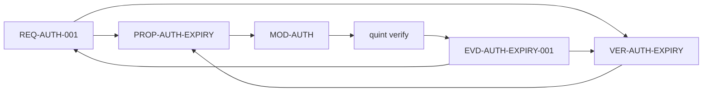

# Formal layer

## Tool

[Quint](https://quint.sh/) owns executable behavior specifications.

Quint provides:

- TypeScript-like syntax;
- a type checker;
- a simulator;
- model checking through Apalache or TLC;
- trace generation;
- model-based testing;
- literate specifications with Markdown.

## Scope

The formal layer models behavior that matters:

- state machines;
- concurrency and interleaving;
- protocols;
- data invariants;
- lifecycle rules;
- authorization rules;
- failure and recovery behavior.

It does not model rendering, subjective quality, or product taste.

## Full formal verification

In this framework, "full formal verification" means:

1. Every approved behavioral requirement links to a Quint property or action and a verification case.
2. The linked Quint module passes type checking and model checking.
3. Conformance traces are replayed against the implementation where an adapter exists.
4. Evidence is stored, hashed, and included in the audit bundle.
5. Requirements that cannot be formalized have a human-approved waiver.

It does not mean that arbitrary implementation code is proven correct. Code proofs require language-specific verifiers and are out of scope unless added later.

## Module structure

```quint
module auth {
  // illustrative, not a complete specification
  type Token = { value: str, expiresAt: int }

  var now: int
  var sessions: Set[str]

  action login(t: Token) = all {
    t.expiresAt > now,
    sessions' = sessions.union(Set(t.value)),
    now' = now,
  }

  action expire(t: Token) = all {
    t.expiresAt <= now,
    sessions' = sessions.exclude(Set(t.value)),
    now' = now,
  }

  invariant no_expired_session =
    sessions.forall(s => s != "")
}
```

The real module must define initialization, environment assumptions, and the properties linked from requirements.

## Requirement mapping



- `REQ-*` carries the readable requirement.
- `VER-*` names the formal verification case and its method.
- `PROP-*` names the checked property.
- `MOD-*` names the Quint module.
- `EVD-*` records the checker run and hashes.
- The audit bundle shows pass/fail, the method, and the property text.

## Properties

### Invariants

Safety conditions that must hold in every reachable state. Example: no session exists for an expired token.

### Temporal properties

Ordering and liveness conditions. Example: every accepted request is eventually completed or rejected.

### Actions

Transitions that must be possible or impossible under stated assumptions. Actions support trace generation and conformance testing.

### Assumptions

Environment constraints are explicit. If an assumption is wrong, the verification result is invalid. Assumptions are listed in the bundle.

## Model checking

Required for approved formal claims:

```bash
quint typecheck spec/formal/auth.qnt
quint verify spec/formal/auth.qnt --invariant no_expired_session
```

The framework records:

- command;
- Quint version;
- Apalache/TLC version;
- scope and depth parameters;
- input file hashes;
- result and counterexample, if any.

A failed property blocks approval of every requirement linked to it.

## Conformance

Model checking verifies the model. Conformance testing checks whether the implementation follows the model.

- **Rust**: Quint Connect replays generated traces against the implementation.
- **Other languages**: a generic trace adapter consumes Quint traces and generates or executes tests.
- **No adapter**: conformance is unverified and must be waived explicitly.

Conformance evidence is separate from model-checking evidence. Both appear in the bundle.

## Literate specifications

Quint's literate mode keeps narrative and formal code in one source. The audit bundle includes:

- the narrative;
- the formal module;
- the property list;
- verification results;
- representative traces.

This lets a human review behavior without reverse-engineering a checker log.

## LLM feedback loop

LLM-generated formal specs are unreliable without feedback. The required loop is:

1. Draft the model and properties.
2. Run the type checker.
3. Run the model checker.
4. Read the counterexample.
5. Repair the model or the requirement.
6. Repeat until the property passes.
7. Human reviews the property meaning, not only the pass result.

The checker is the gate. The LLM never certifies its own model.

## When to use other formal tools

| Need                                                | Tool                |
| --------------------------------------------------- | ------------------- |
| Temporal behavior and concurrency                   | Quint, TLA+         |
| Relational structure, access rules, data invariants | Alloy               |
| Code contracts and proofs in Rust                   | Verus, Kani, Prusti |
| Code contracts in Dafny                             | Dafny               |
| Protocol state machines                             | Quint or TLA+       |

The framework keeps Quint as the default behavior layer. Other tools can be linked as additional evidence.

## Limits

- Model checking explores a bounded scope; it is not a proof for unbounded systems unless the model and tool support it.
- A verified model can still misrepresent intent.
- Conformance tests cover observed traces, not all behavior.
- Non-Rust conformance adapters are later work.
- Code-level proofs are not part of the default scope.
