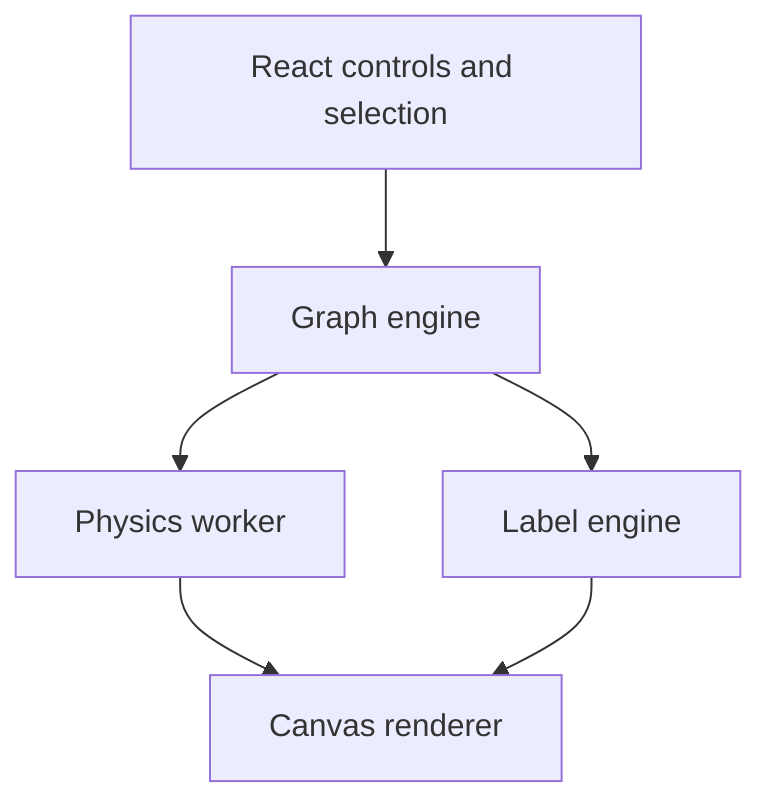

# Graph rendering

Status: partial. Label placement and accessibility hooks are implemented; worker physics, canvas rendering, and large-graph performance validation remain open.

## Purpose

The System view must handle hundreds or thousands of nodes while remaining
readable. It combines the organic feel of a force-directed graph with structured
expansion, label placement, and camera control.

The existing React, d3-force, and canvas implementation is the foundation.

## Physics

Forces:

| Force      | Purpose                       |
| ---------- | ----------------------------- |
| Repulsion  | Separate nodes                |
| Attraction | Pull connected nodes together |
| Damping    | Stabilize movement            |
| Collision  | Prevent overlap               |

Rules:

- preserve positions and velocities across expansion;
- pause when stable;
- restart locally when nodes or edges change;
- keep label placement outside the physics simulation;
- animate transitions instead of snapping.

## Expansion

Strategies:

| Strategy     | Behavior                             |
| ------------ | ------------------------------------ |
| Hierarchical | Reveal children                      |
| Network      | Reveal connected nodes               |
| Hybrid       | Children plus cross-branch neighbors |

Default: hybrid. The user controls depth and can collapse a group.

Expanded children must remain visible. If space is insufficient:

- increase spacing;
- expand the virtual canvas;
- fit the camera;
- allow panning and zooming.

Never silently hide an explicitly expanded child.

## Many children

When a parent has many children:

1. count children;
2. measure their labels;
3. estimate required area;
4. place children radially around the parent;
5. run collision detection;
6. animate into position;
7. fit the camera.

The physics simulation refines positions afterward.

## Labels

Labels are geometric objects.

Measure:

- text width and height;
- font family and size;
- padding;
- node radius;
- viewport bounds.

Placement candidates:

- right, left, above, below;
- choose the position with the lowest collision risk.

Collision avoidance:

- label to label;
- label to node;
- node to node;
- label to viewport edge.

Use a spatial index for measurement and collision.

## Zoom-dependent visibility

| Zoom   | Behavior                              |
| ------ | ------------------------------------- |
| Far    | Nodes and edges; most labels hidden   |
| Medium | Important labels and labels with room |
| Near   | All relevant labels                   |

Priority:

1. selected node;
2. hovered node;
3. root and parent nodes;
4. nearby nodes;
5. distant nodes.

Modes:

- Automatic;
- All;
- Selected.

## Performance

Targets:

| Nodes           | Target         |
| --------------- | -------------- |
| 100 to 500      | Easy           |
| 500 to 2,000    | Smooth         |
| 2,000 to 5,000  | Optimized      |
| 5,000 to 10,000 | Demanding      |
| 10,000+         | Consider WebGL |

Implementation rules:

- run physics in a Web Worker;
- render only visible nodes and edges;
- cache text measurements;
- avoid React re-rendering per animation frame;
- use canvas for nodes, edges, and labels;
- defer heavy analysis to the server;
- paginate or lazy-load symbol expansion.

## Interaction

| Interaction  | Behavior                 |
| ------------ | ------------------------ |
| Single click | Select node              |
| Double click | Expand or collapse       |
| Drag         | Move node                |
| Scroll       | Zoom                     |
| Right click  | Context menu             |
| Search       | Find and reveal node     |
| Trace flow   | Highlight ordered path   |
| Filter       | Limit relationship types |

Each node indicates hidden children or connections.

## Accessibility

- keyboard navigation across visible nodes;
- focus management between graph and inspector;
- screen-reader labels for controls and selection;
- reduced-motion mode;
- touch target sizing;
- no color-only meaning.

## Tests

- label measurement and collision;
- radial placement for many children;
- camera fit;
- expansion state preservation;
- zoom-level visibility;
- worker physics determinism;
- performance fixtures for 100, 500, 2000, and 5000 nodes.
