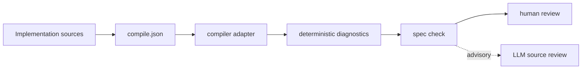

# Implementation layer

**Status:** implemented. This document specifies the compiler preflight adapter, implemented in `src/adapters/compiler.ts`.

## Purpose

The implementation layer turns the project's own build and typecheck commands into deterministic `spec check` diagnostics. It gives humans and agents a cheap preflight before semantic review.

It answers one narrow question:

> Does the implementation compile and typecheck under the configured, pinned command?

It does not answer:

> Does the implementation satisfy the approved requirements?

## Scope

In scope:

- build, compile, and typecheck commands;
- exit codes and bounded diagnostic output;
- missing executables and command failures;
- pinned toolchain versions;
- deterministic command configuration;
- a first gate before optional LLM review.

Out of scope:

- AST parsing, call graphs, and source maps;
- public API compatibility, which belongs to contract adapters;
- requirement conformance and formal properties;
- architecture drift inference;
- code proofs;
- automatic detection of build scripts;
- sandboxing arbitrary build commands.

## Pipeline



The compiler adapter runs before architecture, requirements, formal, and contract adapters. It does not stop the pipeline on failure; all native checks still report, so one run shows the full gap set.

## Configuration

Commands are explicit. There is no shell, no implicit package-manager detection, and no environment expansion.

`spec/implementation/compile.json`:

```json
{
  "checks": [
    {
      "id": "typecheck",
      "command": ["bun", "run", "typecheck"],
      "timeoutMs": 120000
    },
    {
      "id": "build",
      "command": ["bun", "run", "build"],
      "workingDirectory": ".",
      "timeoutMs": 300000
    }
  ]
}
```

Fields:

| Field | Required | Rules |
|---|---|---|
| `id` | yes | unique, non-empty; used in diagnostics |
| `command` | yes | non-empty string array; first element is the executable |
| `workingDirectory` | no | relative to the project root; must resolve inside it |
| `timeoutMs` | no | positive integer; defaults to the process runner default |

Enable the adapter in `spec/config.json`:

```json
{
  "adapters": {
    "implementation": "compiler"
  }
}
```

Without the config entry, the adapter activates only when `spec/implementation/compile.json` exists.

The configuration file is trusted build input. It has the same trust model as `package.json` scripts, a `Makefile`, or `Cargo.toml` build scripts.

## Adapter contract

`CompilerAdapter` implements the existing `NativeAdapter` interface:

| Property | Value |
|---|---|
| `id` | `compiler` |
| `tool` | `compiler` |
| `requiredTools` | empty; executables come from configuration |
| `detect` | true when `spec/implementation/compile.json` exists |
| `run` | executes each configured check once |

Execution rules:

- resolve the executable through the project tool locator;
- run with an explicit working directory inside the project;
- never invoke a shell;
- enforce the configured timeout;
- bound output to the last 500 characters;
- fail closed on malformed configuration;
- report one diagnostic per failing check.

## Diagnostics

| Code | Meaning |
|---|---|
| `IMPL-COMPILE-NO-CONFIG` | adapter is explicitly enabled but `compile.json` is missing |
| `IMPL-COMPILE-BAD-CONFIG` | invalid JSON, invalid shape, duplicate id, or escaping working directory |
| `IMPL-COMPILE-NO-CHECKS` | configuration contains no checks |
| `IMPL-COMPILE-MISSING-TOOL` | configured executable is not available |
| `IMPL-COMPILE-RUN` | spawn, I/O, or timeout failure; includes the underlying code |
| `IMPL-COMPILE-FAILED` | non-zero exit; includes check id, exit code, and output tail |
| `IMPL-UNKNOWN-ADAPTER` | `adapters.implementation` names an unsupported adapter |

All diagnostics point at `spec/implementation/compile.json`. A compiler preflight failure is an error, not a warning. Waiving it is out of scope for the first slice.

## Determinism and evidence

The adapter is deterministic only relative to its inputs:

- exact command line;
- exact working directory;
- pinned toolchain in `spec/toolchain.lock.json`;
- bounded timeout;
- project source state.

The adapter records command, input hashes, result, and bounded failure output as evidence. `spec approve` hashes that evidence into `spec.lock` and stores the full record under `spec/evidence/`. `spec check` reports changed or missing approved evidence when native checks regenerate the snapshot.

Compiler output can vary across toolchain versions, locale, and incremental build state. The adapter must not normalize away actionable errors. It must keep the command and tool version in the eventual evidence record so a reviewer can reproduce the verdict.

## Relationship to other layers

| Layer | Relationship |
|---|---|
| Contracts | The compiler remains the source of truth for types. Contract adapters record the public surface and compatibility evidence. A green compile is not a compatibility verdict. |
| Formal | Compiler preflight is not conformance. Quint typechecking and model checking remain the authority for formal claims. |
| Discovery | Compiler and package metadata may later inform dependency edges and drift reports. The first slice does not parse source. |
| LLM review | Advisory only. LLM findings are drafts with provenance, never evidence, and never a pass verdict. |
| Approval | Compiler failure blocks the affected check. It does not approve or invalidate approved content by itself. |

## Security

Build commands execute project code. The framework does not sandbox them.

Mitigations in the first slice:

- explicit argument arrays, never a shell;
- working directory constrained to the project root;
- one timeout per check;
- bounded output;
- configuration reviewed like any other build script.

Host-level sandboxing remains the responsibility of the execution environment, consistent with the security non-goals.

## Planned implementation

| File | Change |
|---|---|
| `src/adapters/compiler.ts` | new `CompilerAdapter` |
| `src/core/config.ts` | add `adapters.implementation` |
| `src/core/check.ts` | select and run the adapter first in the native phase |
| `src/core/init.ts` | scaffold `spec/implementation/README.md` |
| `tests/compiler.test.ts` | adapter behavior and failure fixtures |
| `tests/config.test.ts` | configuration validation |
| `tests/check.test.ts` | integration, ordering, unknown adapter, structural skip |
| `tests/init.test.ts` | scaffold coverage |

Acceptance criteria:

- a passing check produces no diagnostics;
- a non-zero exit produces `IMPL-COMPILE-FAILED` with a bounded tail;
- a missing executable produces `IMPL-COMPILE-MISSING-TOOL` without spawning;
- malformed configuration fails closed;
- `spec check --structural` does not run the adapter;
- `bun test` and `bun run typecheck` pass.

## Open questions

- Should `spec init --existing` auto-detect package scripts or only scaffold the README?
- Should the adapter accept one check or support multiple implementation adapters later?
- Should compile failures be waivable, and under what scope and expiry?
- How should diagnostics be normalized across languages without hiding actionable detail?
- Should `spec doctor` resolve arbitrary configured executables, or leave that to `spec check`?
- When should compiler evidence be regenerated automatically by the audit bundle rather than by approval?
