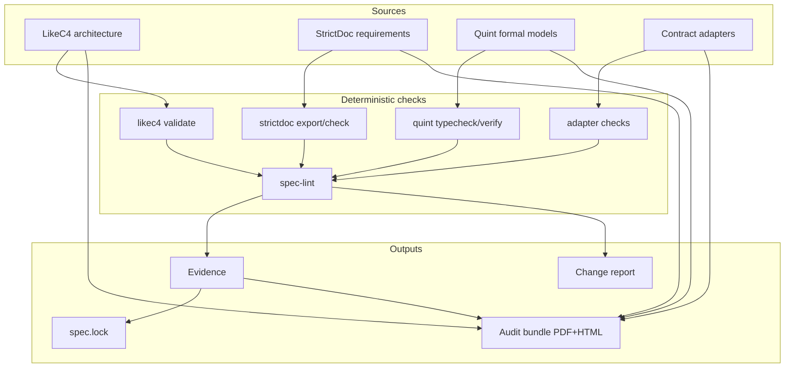
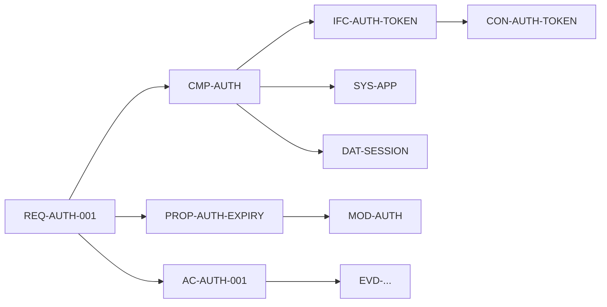

# Architecture overview

## Layers

## Sources of truth

| Concern | Source | Authority |
|---|---|---|
| Systems, components, relations | LikeC4 model | Architecture linter and human review |
| Requirements, acceptance criteria, traceability | StrictDoc documents | StrictDoc validation and spec-lint |
| Behavior, invariants, temporal properties | Quint modules | Quint type checker and model checker |
| Language APIs | Language toolchain output | Contract adapter |
| Data formats | JSON Schema, CUE, CDDL, or Protobuf | Contract adapter |
| CLI behavior | Help snapshots and contract tests | Contract adapter |
| Wire protocols | Protobuf, CDDL, or protocol schema | Contract adapter |
| Approval | `spec.lock` plus signed tag | Human |
| Readable output | Generated audit bundle | Deterministic renderer |

No layer owns the whole truth. Links between layers are stable IDs. The glue ensures the graph is closed: every reference resolves and every required relation exists.

## ID flow

- Requirements reference components and formal properties.
- Components reference systems and interfaces.
- Interfaces reference contracts.
- Formal properties reference Quint modules and evidence.
- Acceptance criteria reference evidence.
- Evidence references hashes of inputs and tool versions.

## Pipeline

1. **Collect** sources: LikeC4 export, StrictDoc JSON export, Quint metadata, adapter output.
2. **Validate** each source with its native tool.
3. **Link** entities by ID and check cross-layer rules.
4. **Verify** formal properties and conformance tests; store evidence.
5. **Gate** on unapproved changes, unanswered questions, expired waivers, missing links.
6. **Render** the audit bundle and change report.
7. **Approve** specific element hashes; update `spec.lock`.

## Deterministic versus probabilistic

| Deterministic | Probabilistic |
|---|---|
| LikeC4 validation | Requirement drafting |
| StrictDoc grammar and traceability | Architecture proposals |
| Quint type checking and model checking | Formal model drafting |
| Contract adapters | Contract drafting |
| ID and coverage lint | Rationale text |
| Audit bundle rendering | Change summaries |
| Approval hash checks | Interview questions |

The probabilistic side accelerates authoring. It never provides a pass verdict.

## Failure behavior

- A missing native tool fails the pipeline; no silent skip.
- A missing optional adapter is reported as a gap.
- A failing formal property blocks approval of the linked requirement.
- An unapproved content change invalidates prior approval.
- A dirty git tree fails bundle generation unless explicitly allowed for local preview.
- Generated artifacts never overwrite sources.

## Extensibility

New project types are supported by adding contract adapters and, if necessary, element kinds. The core does not encode HTTP, Rust, or any specific architecture style. The default metamodel is a starting point, not a constraint.
