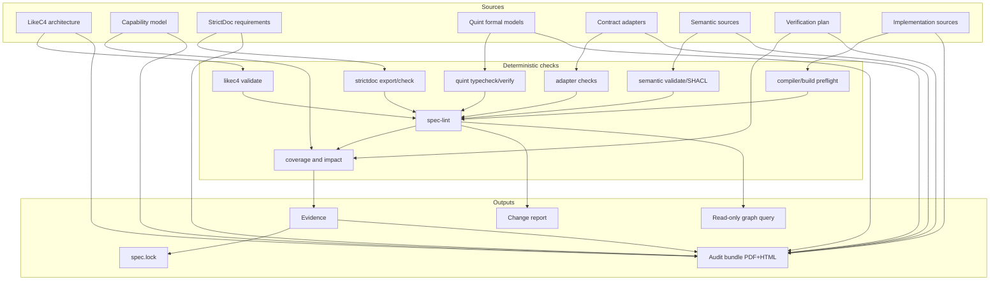
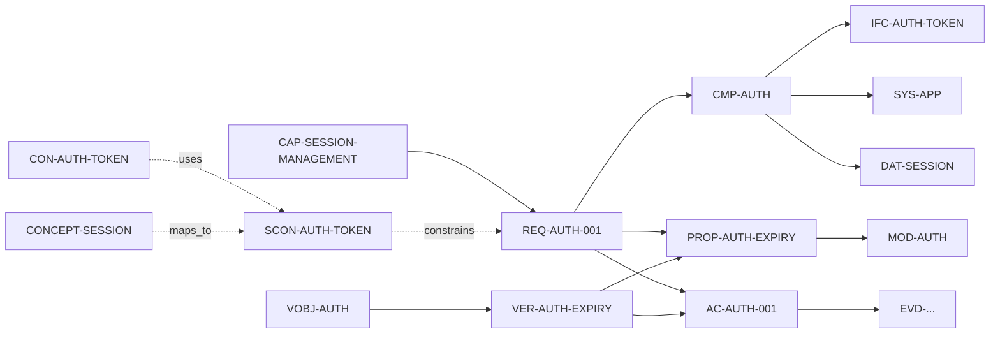

# Architecture overview

## Layers

## Sources of truth

| Concern                                         | Source                                          | Authority                             |
| ----------------------------------------------- | ----------------------------------------------- | ------------------------------------- |
| Systems, components, relations                  | LikeC4 model                                    | Architecture linter and human review  |
| Capabilities and capability hierarchy           | Capability model linked to LikeC4 and StrictDoc | Capability lint and human review      |
| Requirements, acceptance criteria, traceability | StrictDoc documents                             | StrictDoc validation and spec-lint    |
| Ontologies, concepts, semantic contracts        | RDF/OWL/SKOS/SHACL sources                      | Semantic adapter and SHACL validation |
| Verification objectives and methods             | Verification plan linked to requirements        | Coverage and evidence checks          |
| Behavior, invariants, temporal properties       | Quint modules                                   | Quint type checker and model checker  |
| Implementation syntax, types, and build state   | Compiler or build tool                          | Compiler preflight adapter            |
| Language APIs                                   | Language toolchain output                       | Contract adapter                      |
| Data formats                                    | JSON Schema, CUE, CDDL, or Protobuf             | Contract adapter                      |
| CLI behavior                                    | Help snapshots and contract tests               | Contract adapter                      |
| Wire protocols                                  | Protobuf, CDDL, or protocol schema              | Contract adapter                      |
| Approval                                        | `spec.lock` plus signed tag                     | Human                                 |
| Readable output                                 | Generated audit bundle                          | Deterministic renderer                |
| Agent access                                    | Read-only graph query and MCP                   | Stable query contract                 |
| Review surface                                  | Read-only Explorer                              | Validated graph, never a source       |

No layer owns the whole truth. Links between layers are stable IDs. The glue ensures the graph is closed: every reference resolves and every required relation exists.

## ID flow

- Capabilities anchor requirements and verification objectives.
- Requirements reference capabilities, components, contracts, and formal properties.
- Components reference systems and interfaces.
- Interfaces reference contracts.
- Contracts can be constrained by semantic contracts built on ontology terms.
- Formal properties reference Quint modules and evidence.
- Verification objectives group verification cases across capabilities and requirements.
- Verification cases reference methods, targets, properties, contracts, and evidence.
- Acceptance criteria reference evidence.
- Evidence references hashes of inputs and tool versions.

## Pipeline

1. **Collect** sources: LikeC4 export, capability model, StrictDoc JSON export, Quint metadata, semantic graph, verification plan, compiler output, adapter output.
2. **Validate** each source with its native tool, starting with compiler preflight.
3. **Link** entities by ID and check cross-layer rules.
4. **Verify** formal properties, conformance tests, semantic constraints, and planned verification cases; store evidence.
5. **Gate** on unapproved changes, unanswered questions, expired waivers, missing links, uncovered capabilities, and unverified obligations.
6. **Render** the audit bundle, change report, and read-only graph query.
7. **Approve** specific element hashes; update `spec.lock`.

## Deterministic versus probabilistic

| Deterministic                            | Probabilistic                         |
| ---------------------------------------- | ------------------------------------- |
| LikeC4 validation                        | Requirement drafting                  |
| Capability coverage and hierarchy checks | Capability proposals                  |
| StrictDoc grammar and traceability       | Architecture proposals                |
| Semantic validation and SHACL checks     | Ontology and vocabulary drafting      |
| Quint type checking and model checking   | Formal model drafting                 |
| Verification plan coverage checks        | Verification strategy drafting        |
| Compiler and build preflight             | Source review and requirement mapping |
| Contract adapters                        | Contract drafting                     |
| ID, coverage, and impact lint            | Rationale text                        |
| Audit bundle rendering                   | Change summaries                      |
| Read-only graph queries                  | Explanation and prioritization        |
| Approval hash checks                     | Interview questions                   |

The probabilistic side accelerates authoring. It never provides a pass verdict.

## Failure behavior

- A missing native tool fails the pipeline; no silent skip.
- A missing semantic tool fails the pipeline only when the semantic layer is active.
- A failing compiler preflight fails the pipeline; it is not a conformance verdict.
- A missing optional adapter is reported as a gap.
- A blocking semantic violation blocks approval of the linked element.
- A failing formal property blocks approval of the linked requirement.
- A verification case without evidence blocks approval of the linked obligation.
- A query or Explorer failure does not change validation or approval state.
- An unapproved content change invalidates prior approval.
- A dirty git tree fails bundle generation unless explicitly allowed for local preview.
- Generated artifacts never overwrite sources.

## Extensibility

New project types are supported by adding contract adapters and, if necessary, element kinds. The optional semantic adapter adds vocabulary and SHACL constraints without changing the core. The core does not encode HTTP, Rust, or any specific architecture style. The default metamodel is a starting point, not a constraint.
