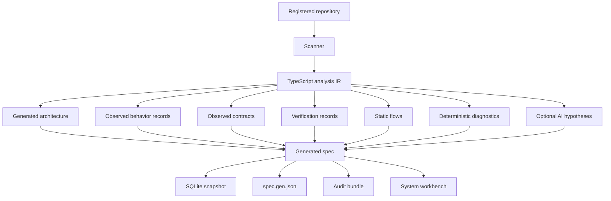

# Architecture overview

The generated spec product has one evidence pipeline and one generated model.
Curated intent, proposals, and hash-locked approval are retired by decision
record [0016](../design-decisions/0016-generated-spec-product.md).

## Pipeline



## Layers

| Layer                   | Source                                       | Authority     | Output                                                                    |
| ----------------------- | -------------------------------------------- | ------------- | ------------------------------------------------------------------------- |
| Repository evidence     | Source files and manifests                   | Generated     | Files, symbols, imports, calls, entry points, data access                 |
| Conceptual architecture | Entry points, interfaces, calls, data access | Generated     | System, subsystems, components, interfaces, data stores, external systems |
| Implementation mapping  | IR and behavior reachability                 | Generated     | Files and symbols mapped to conceptual elements                           |
| Observed behavior       | Entry points, public surface, calls          | Generated     | Behavior records with evidence                                            |
| Observed contracts      | Package exports, routes, CLI, public API     | Generated     | Contract records                                                          |
| Verification            | Tests, compiler, configured checks           | Generated     | Verification targets and derived check runs                               |
| Flows                   | Resolved call graph and data access          | Generated     | Entry-to-source/sink paths                                                |
| Diagnostics             | Graph metrics, cycles, mapping coverage      | Deterministic | Findings                                                                  |
| AI interpretation       | Generated context                            | AI-inferred   | Hypotheses and explanations                                               |

No layer claims approval or completeness.

## Sources of truth

| Concern                              | Source                               |
| ------------------------------------ | ------------------------------------ |
| Repository files and metadata        | Filesystem and Git                   |
| Symbols, calls, imports, data access | Analysis IR                          |
| Architecture hierarchy               | Behavior-derived reconstruction      |
| Observed behavior                    | Behavior graph and entry anchors     |
| Observed contracts                   | Generated contract collector         |
| Verification evidence                | Generated check and test collectors  |
| Flows                                | Flow analyzer                        |
| Deterministic findings               | Diagnostics engine                   |
| AI hypotheses                        | Validated AI output, clearly labeled |
| Snapshots                            | Local SQLite                         |
| Portable output                      | `spec/generated/spec.gen.json`       |
| Human review metadata                | `.spec/` annotations                 |
| Readable output                      | Generated audit bundle               |

## Inputs and outputs

Inputs:

- registered repository root;
- `spec-framework.json` at repository root;
- Git state;
- optional analysis roots and exclusions;
- optional configured external checks;
- optional AI provider configuration outside the repository.

Outputs:

```text
.spec/analysis.sqlite
spec/generated/spec.gen.json
spec/generated/analysis.gen.json
spec/generated/architecture.gen.c4
spec/generated/requirements.gen.sdoc
spec/audit/
```

`spec/` contains generated output only. `spec-framework.json` is the committed
input. Do not hand-edit generated files.

## Failure behavior

- Missing or unreadable repository root fails the analysis request.
- Unresolved calls become findings or unknowns, never guessed edges.
- Missing optional checks are reported as unknowns.
- A failed analysis never deletes the last successful snapshot.
- A stale snapshot is shown with its commit and version metadata.
- AI failures never block deterministic analysis.
- AI output with invalid references is rejected.
- Workbench failure never changes generated output.
