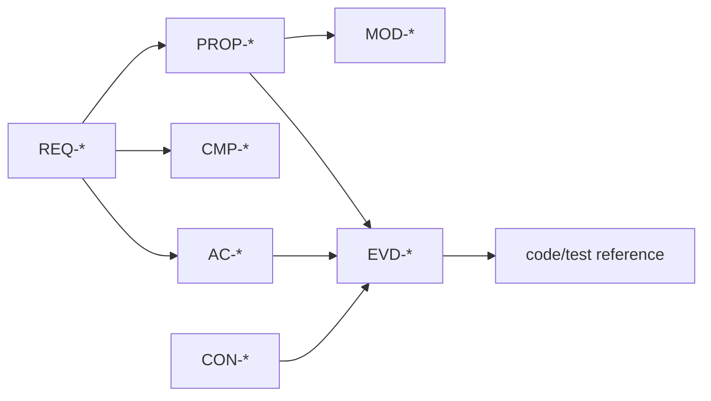

# Requirements layer

## Tool

[StrictDoc](https://strictdoc-project.github.io/) is the requirements and audit backbone.

It provides:

- plain-text SDoc or Markdown documents;
- stable UIDs and strict grammar;
- custom fields and custom grammar;
- parent/child/file traceability;
- traceability matrix and coverage views;
- project tree diff and changelog;
- HTML and PDF export;
- ReqIF and Excel interchange;
- optional source-code coverage.

## Why StrictDoc

- Designed for audit-oriented requirements, not generic documentation.
- Text-based and Git-friendly.
- renderable as a formal PDF package.
- Supports custom fields needed for provenance, formalization, evidence, and approval.
- Has diff and traceability features that a custom Markdown generator would have to rebuild.

Doorstop is a lighter alternative with built-in review fingerprints. OpenFastTrace is a strong optional tracer for requirement-to-code tags. StrictDoc is the primary audit surface.

## Requirement fields

The default custom grammar requires:

- `UID` — stable ID such as `REQ-AUTH-001`;
- `TITLE`;
- `STATUS` — `Draft`, `Proposed`, `Approved`, `Deprecated`;
- `STATEMENT` — EARS form;
- `RATIONALE` — optional non-normative explanation;
- `ACCEPTANCE` — one or more `AC-*` IDs;
- `COMPONENT` — one or more `CMP-*` IDs;
- `FORMAL` — one or more `PROP-*` or `INV-*` IDs, or `none`;
- `EVIDENCE` — evidence IDs;
- `PROVENANCE` — provenance form;
- `OWNER`;
- `PRIORITY`;
- `WAIVER` — optional waiver ID when unverified.

## EARS forms

| Form | Template | Use |
|---|---|---|
| Ubiquitous | The `<system>` shall `<response>`. | Always-on behavior |
| Event-driven | When `<trigger>`, the `<system>` shall `<response>`. | Reactions |
| State-driven | While `<state>`, the `<system>` shall `<response>`. | Mode-dependent behavior |
| Unwanted | If `<condition>`, then the `<system>` shall `<response>`. | Failure handling |
| Optional feature | Where `<feature>`, the `<system>` shall `<response>`. | Variants |

The linter rejects normative statements that do not match an allowed form. Rationale text is not normatively scanned.

## Acceptance criteria

Each requirement has at least one acceptance criterion. A criterion is a checkable claim linked to evidence:

```text
[REQUIREMENT]
UID: AC-AUTH-001
TITLE: Expired token produces TOKEN_EXPIRED
STATUS: Draft
STATEMENT: Given an expired session token, the authentication component returns TOKEN_EXPIRED and does not create a session.
FORMAL: PROP-AUTH-EXPIRY
EVIDENCE: EVD-AUTH-EXPIRY-001
PROVENANCE: human:joao@2026-11-10
OWNER: security
```

The criterion uses defined terms and observable outcomes. It does not say "works correctly."

## Traceability



Minimum links for approval:

- requirement → acceptance criterion;
- requirement → component;
- requirement → formal property or waiver;
- acceptance criterion → evidence;
- evidence → source/tool hashes.

StrictDoc owns requirement hierarchy and file relations. Cross-layer links use custom fields and are checked by `spec-lint`.

## Review surface

The audit bundle includes:

- requirements grouped by system and component;
- status and priority;
- EARS statement;
- acceptance criteria;
- formalization and evidence links;
- coverage and traceability matrices;
- unknowns and waivers;
- change history.

The reviewer reads the PDF/HTML, not the raw SDoc.

## Diff and change review

StrictDoc's project tree diff produces a changelog between versions. The framework adds an impact report:

- changed requirement IDs;
- affected components and contracts;
- invalidated evidence;
- newly failing or unverified properties;
- approvals that must be renewed.

## Coverage policy

- No approved requirement without a formalization or waiver.
- No approved acceptance criterion without evidence.
- No orphan requirement without a parent system/component link.
- No duplicate normative statement across requirements; merge or refine.
- No normative term without a glossary entry.

## Non-goals

- StrictDoc is not the architecture model.
- StrictDoc is not the formal verifier.
- StrictDoc does not decide whether a requirement is good; it makes missing structure visible.
