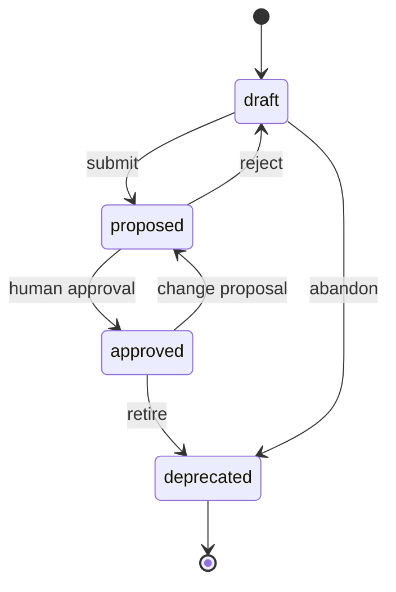

# Spec model

## Element kinds

| Prefix     | Kind                   | Purpose                                                       |
| ---------- | ---------------------- | ------------------------------------------------------------- |
| `SYS-`     | System                 | Top-level boundary and scope                                  |
| `CMP-`     | Component              | Unit with a responsibility and owner                          |
| `IFC-`     | Interface              | Boundary exposed by a component                               |
| `DAT-`     | Data entity            | Persistent or transferred data with an owner                  |
| `REQ-`     | Requirement            | Normative statement with acceptance criteria                  |
| `CAP-`     | Capability             | Coherent system ability and stable semantic anchor            |
| `AC-`      | Acceptance criterion   | Checkable condition linked to evidence                        |
| `VOBJ-`    | Verification objective | Scope, sequencing, and grouping of verification work          |
| `VER-`     | Verification case      | Concrete check with a method, target, and evidence            |
| `INV-`     | Invariant              | Property that must hold in all reachable states               |
| `MOD-`     | Formal module          | Quint module grouping actions and properties                  |
| `PROP-`    | Formal property        | Checked invariant or temporal property                        |
| `CON-`     | Contract               | Language API, data schema, CLI, wire, or hardware contract    |
| `ONTO-`    | Ontology               | Structural classes, properties, individuals, and axioms       |
| `VOC-`     | Concept scheme         | Curated vocabulary with a stable IRI base and prefix          |
| `CONCEPT-` | Concept                | Labeled term with synonyms, definition, and taxonomy links    |
| `SCON-`    | Semantic contract      | Reusable SHACL profile constraining requirements or contracts |
| `EVD-`     | Evidence               | Verification artifact with input and tool hashes              |
| `UNK-`     | Unknown                | Open question with owner and blocking status                  |
| `WVR-`     | Waiver                 | Human-approved exception with scope and expiry                |
| `DEC-`     | Decision               | Architecture or design decision record                        |
| `TERM-`    | Term                   | Glossary definition                                           |

IDs are stable and never reused. Deprecated elements keep their ID and status.

These identifiers are internal identity, not the default human interface. The
experience layer shows titles, plain-language state, and named questions. The
audit bundle keeps the full identity. See
[presentation and internal identity](../ux/presentation.md).

## Required fields

Every element has:

- `id`: stable identifier;
- `kind`: one of the element kinds;
- `title`: short human-readable label;
- `status`: `draft`, `proposed`, `approved`, or `deprecated`;
- `provenance`: origin of the element;
- `owner`: human or role accountable for it;
- `rationale`: optional non-normative explanation;
- `links`: typed relations to other IDs.

## Provenance

Allowed provenance forms:

| Form                   | Meaning                                     |
| ---------------------- | ------------------------------------------- |
| `human:<name>@<date>`  | Human decision or answer                    |
| `code:<path>#<symbol>` | Derived from an implementation artifact     |
| `doc:<path>#<anchor>`  | Derived from a document                     |
| `inferred:<id>`        | Inferred from another spec element          |
| `assumption:<id>`      | Explicit assumption, surfaced in the bundle |

An element without provenance is invalid. An assumption is not an unknown: it is a claim accepted provisionally, and it must appear in the audit bundle.

## Relations

Relations are typed fields, not sentences.

| Relation                   | From                                     | To                                             | Meaning                         |
| -------------------------- | ---------------------------------------- | ---------------------------------------------- | ------------------------------- |
| `part_of`                  | component or capability                  | system, component, or capability               | Containment                     |
| `depends_on`               | component                                | component or system                            | Runtime or build dependency     |
| `exposes`                  | component                                | interface                                      | Provides an interface           |
| `consumes`                 | component                                | interface                                      | Uses an interface               |
| `reads` / `writes`         | component                                | data entity                                    | Data access                     |
| `owns`                     | component                                | data entity                                    | Accountability for data         |
| `publishes` / `subscribes` | component                                | event or interface                             | Event production or consumption |
| `implements`               | component                                | requirement or interface                       | Realization                     |
| `satisfies`                | component                                | requirement                                    | Architectural satisfaction      |
| `realizes`                 | component                                | capability                                     | Capability realization          |
| `derives_from`             | requirement                              | capability                                     | Requirement derivation          |
| `refines`                  | requirement, component, or capability    | matching kind                                  | Detail relation                 |
| `verifies`                 | evidence, property, or verification case | requirement, acceptance criterion, or contract | Verification link               |
| `targets`                  | verification objective                   | capability or requirement                      | Verification scope              |
| `derives_from`             | verification case                        | verification objective                         | Verification decomposition      |
| `satisfied_by`             | verification case                        | evidence                                       | Execution evidence              |
| `uses`                     | semantic contract or verification case   | ontology term, property, or contract           | Dependency                      |
| `used_by`                  | ontology term                            | semantic contract                              | Reverse dependency              |
| `constrains`               | semantic contract                        | requirement or contract                        | Machine-checkable constraint    |
| `constrained_by`           | requirement or contract                  | semantic contract                              | Reverse constraint              |
| `defines`                  | ontology or concept scheme               | concept or ontology term                       | Term definition                 |
| `maps_to`                  | concept or term                          | external term                                  | Explicit vocabulary mapping     |
| `replaces`                 | element                                  | element                                        | Deprecation relation            |

Cardinality and allowed endpoint kinds are checked by the linter.

## Status lifecycle



Rules:

- `approved` elements are hash-locked.
- Only `approved` elements may be implemented.
- Changing an approved element moves it back to `proposed`.
- Deprecation is explicit; deletion is not allowed.
- Evidence for `approved` elements must have a current hash.

## Question matrix

Completeness is defined relative to mandatory questions per element kind. For example:

### Component

- What is its single responsibility?
- What is its boundary (in scope, out of scope)?
- What does it expose and consume?
- What data does it own or access?
- What are its failure modes?
- How is it deployed or instantiated?
- Who owns it?

### Interface

- What are the operations, inputs, outputs, and errors?
- What are the preconditions and postconditions?
- Is it idempotent? What is retried?
- What are the limits, timeouts, and backpressure behavior?
- What is the authorization model?
- How is it versioned?
- What is the compatibility policy?

### Requirement

- What is the normative statement in EARS form?
- What are the acceptance criteria?
- Which capability does it derive from, or is it infrastructure?
- What formal property, verification case, or contract verifies it?
- Which semantic constraints apply?
- What are the edge cases?
- What is the priority and owner?
- What is the source or rationale?
- What happens when the requirement cannot be satisfied?

### Capability

- What ability does the system provide?
- Who needs it, and in what operational context?
- How does it decompose into narrower capabilities?
- Which requirements derive from it?
- Which verification objective targets it?
- Who owns it?
- What is explicitly out of scope?

### Ontology

- What vocabulary does it define?
- What are its IRI base and prefix?
- Which classes, properties, and individuals are normative?
- Which external vocabularies does it import, and at which pinned version?
- Which concepts or requirements use its terms?
- Who owns it?
- What reasoning or validation scope is claimed?

### Semantic contract

- Which obligation does it constrain?
- Which ontology terms and shapes does it use?
- What severity are violations?
- Which requirements or contracts are constrained?
- Which evidence records validation?
- Who owns it?
- What is not covered by the shapes?

### Verification objective

- What scope does it cover?
- Which capabilities and requirements does it target?
- What ordering or dependency exists between objectives?
- Which verification cases derive from it?
- What completion criteria apply?
- Who owns it?

### Verification case

- Which target does it verify?
- Which method is used: formal, test, analysis, inspection, or demonstration?
- What inputs, environment, and tool versions are required?
- What result counts as pass or fail?
- Which evidence records the execution?
- What is explicitly unverified?
- Who reviews the result?

Each question must have an answer, a linked unknown, or a waiver. Unanswered questions fail lint.

## Edge-case matrix

Every behavior answers:

- empty or absent input;
- minimum and maximum size;
- concurrent or interleaved execution;
- retry and duplicate delivery;
- partial failure;
- unauthorized or invalid input;
- dependency unavailable;
- restart and recovery;
- cancellation and timeout;
- clock, ordering, or identity assumptions.

Undefined cells become unknowns or waivers. They are not silently omitted.

## Unknowns and waivers

```yaml
# illustrative shape; stored in the selected tool
id: UNK-AUTH-003
question: What happens when the token store is unavailable during refresh?
owner: security
blocking: true
links: [REQ-AUTH-004]
```

```yaml
id: WVR-PERF-001
scope: REQ-PERF-002
reason: Benchmark environment not reproducible in CI yet
owner: joao
expires: 2026-12-31
links: [REQ-PERF-002]
```

Expired waivers fail. Blocking unknowns prevent approval. Non-blocking unknowns are listed in the audit bundle.

## Example requirement record

```text
[REQUIREMENT]
UID: REQ-AUTH-001
TITLE: Expired session tokens are rejected
STATUS: Draft
STATEMENT: When a session token is expired, the authentication component shall reject the request with error code TOKEN_EXPIRED.
RATIONALE: Prevent use of stale credentials.
CAPABILITY: CAP-SESSION-MANAGEMENT
ACCEPTANCE: AC-AUTH-001
COMPONENT: CMP-AUTH
FORMAL: PROP-AUTH-EXPIRY
VERIFICATION: VOBJ-AUTH, VER-AUTH-EXPIRY
CONTRACTS: SCON-AUTH-TOKEN
EVIDENCE: EVD-AUTH-EXPIRY-001
PROVENANCE: human:joao@2026-11-10
OWNER: security
```

The exact syntax is defined by the adapter; the fields and links are the model.
