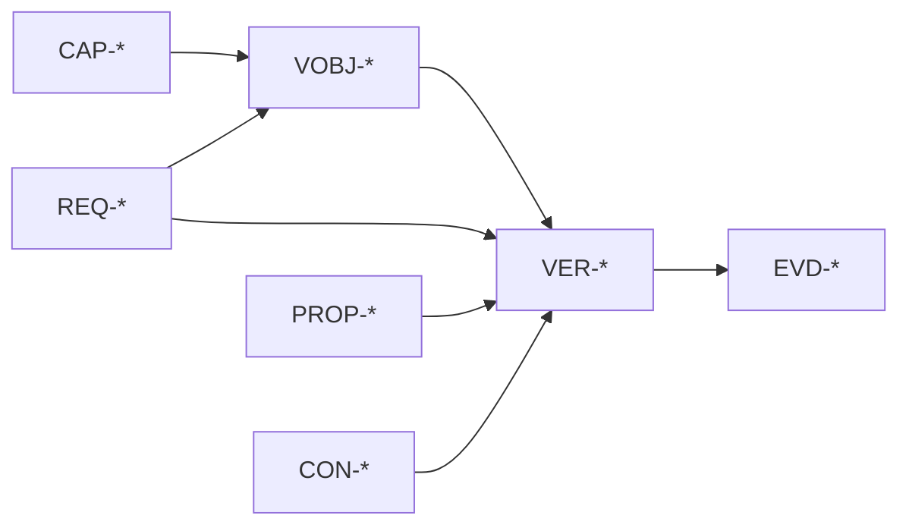

# Verification layer

> Status: Phase 2 design. Verification planning tooling is not implemented.

## Purpose

The verification layer plans how obligations are checked. It separates planning
from execution evidence and makes verification coverage visible before approval.

Formal model checking is one verification method. It is not the whole
verification plan.

## Element kinds

| Prefix  | Kind                   | Purpose                                              |
| ------- | ---------------------- | ---------------------------------------------------- |
| `VOBJ-` | Verification objective | Scope, sequencing, and grouping of verification work |
| `VER-`  | Verification case      | A concrete check with a method, target, and evidence |

A verification objective organizes work across capabilities and requirements.
A verification case derives from an objective or verifies a requirement directly.

## Methods

| Method        | Meaning                                      | Typical evidence                      |
| ------------- | -------------------------------------------- | ------------------------------------- |
| Formal        | Model checking or proof of a formal property | Quint/Apalache result, counterexample |
| Test          | Executable test or conformance trace replay  | Test log, trace replay result         |
| Analysis      | Static or measured analysis                  | Analyzer report, benchmark result     |
| Inspection    | Human review against a checklist             | Signed inspection record              |
| Demonstration | Observed operation in a controlled scenario  | Demonstration log or recording        |

The method is explicit. A test result is not formal evidence, and a model-checking
pass is not conformance evidence.

## Links

Relations:

- `targets` connects a verification objective to a capability or requirement;
- `derives_from` connects a verification case to an objective;
- `verifies` connects a verification case to a requirement, acceptance
  criterion, or contract;
- `uses` connects a verification case to a formal property or contract;
- `satisfied_by` connects a verification case to evidence.

## Coverage

Verification coverage reports:

- requirements with no verification case and no waiver;
- acceptance criteria with no evidence;
- verification cases with no target;
- verification cases with no evidence;
- verification objectives with no cases;
- formal properties without model-checking evidence;
- contracts without compatibility evidence;
- expired waivers.

Coverage rolls up through requirements and capabilities. A capability is covered
only when its obligations are covered or explicitly waived.

## Evidence

Each verification case records:

- case ID and method;
- target IDs;
- tool and version;
- command or procedure;
- input hashes;
- scope and parameters;
- result;
- counterexample, failure, or inspection finding;
- timestamp and operator or environment.

Evidence is hashed in `spec.lock`. Changing the case, target, input, or tool
invalidates the evidence.

## Relationship to formal verification

The formal layer remains the authority for executable behavior. The verification
layer adds:

- non-formal methods;
- planning and grouping;
- coverage across all requirement types;
- explicit unverified scope.

A requirement can link to a formal property and a verification case. The audit
bundle shows both the property result and the case method. They are not merged
into one verdict.

## Waivers

A waiver can cover one of:

- a requirement that cannot be verified;
- a verification case that cannot run in the current environment;
- a contract with no compatibility adapter;
- a manual inspection with no machine evidence.

A waiver records scope, owner, reason, and expiry. Expired waivers fail. Waivers
appear in the audit bundle, never only in a review comment.

## Change impact

Changing a verification objective, case, method, or input affects:

- evidence hashes;
- linked requirements and acceptance criteria;
- approvals that depend on the evidence;
- capability coverage;
- the release gate.

Evidence is regenerated; it is not copied forward.

## Non-goals

- Replacing formal model checking with test plans.
- Treating an inspection as stronger evidence than it is.
- Requiring a verification case for non-normative prose.
- Hiding unverified requirements in aggregate coverage numbers.
