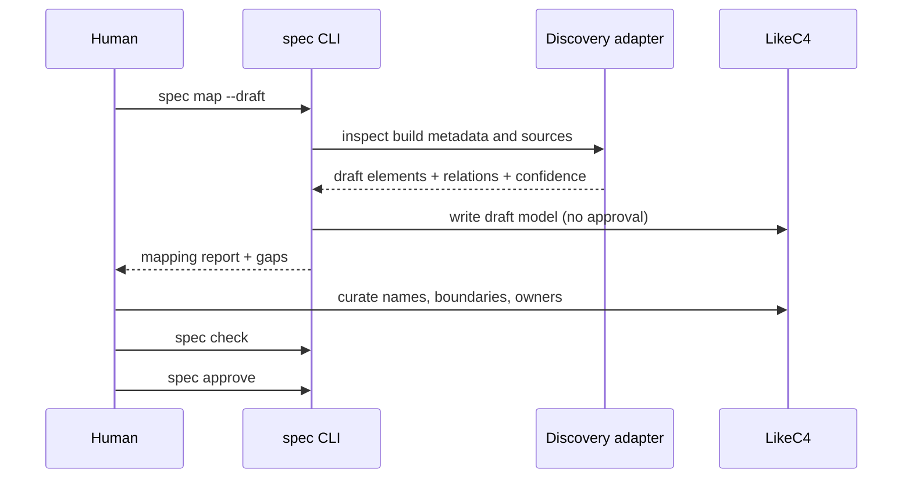

# Brownfield mapping

> Status: `spec map --draft`, the `spec map --review` entry with area and
> relation curation, the local workbench, promotion into proposed architecture,
> architecture approval, and `spec map --check` drift findings are implemented.
> See [use-case modes](workflow/use-cases.md).

## Principle

Code describes implemented behavior. It does not describe intent, scope, priorities, or acceptable tradeoffs. Mapping code into a specification produces a **draft model**, not approved architecture.

## What mapping extracts

| Source          | Extracted                              | Provenance            |
| --------------- | -------------------------------------- | --------------------- |
| Build metadata  | workspaces, crates, packages, binaries | `code:cargo metadata` |
| Module tree     | modules, directories, namespaces       | `code:<manifest>`     |
| Public API      | functions, traits, types, signatures   | `code:rustdoc JSON`   |
| Import graph    | dependencies between modules           | `code:<manifest>`     |
| CLI definitions | commands, flags, exit behavior         | `code:<source>`       |
| Existing docs   | requirements, decisions, rationale     | `doc:<path>`          |
| Tests           | checks and examples, not intent        | `code:<test path>`    |

## What mapping must not claim

- It must not mark extracted elements `approved`.
- It must not infer requirements from implementation details.
- It must not infer capabilities, ontologies, or verification plans from code structure.
- It must not invent ownership or responsibility.
- It must not treat tests as complete acceptance criteria.
- It must not claim a boundary it cannot observe.
- It must not hide uncertainty; low-confidence relations are marked.

## Workflow

1. Human runs `spec map --draft`.
2. Discovery adapters emit draft elements and relations with provenance.
3. The mapping report lists low-confidence elements, missing owners, missing contracts, and unobserved boundaries.
4. Human curates the model in LikeC4 or runs `spec map --review` for the
   interactive path.
5. `spec map --promote` writes accepted areas into proposed architecture.
6. `spec check` runs architecture validation and cross-layer checks.
7. Human approves the reviewed elements.
8. `spec map --check` reports drift against the approved subset.

## Interactive mapping

A static draft is a starting point, not the mapping workflow. Interactive
mapping shows the graph, the confidence queue, and the questions code cannot
answer.

- `spec map --review` opens the [workbench](workflow/workbench.md) or an
  equivalent terminal review.
- The human accepts, rejects, renames, merges, splits, assigns owners, records
  open questions, and accepts or rejects uncertain relations.
- Every action is a typed proposal operation on the same-worktree proposal
  branch.
- Inferred, ambiguous, and unknown relations appear in a relation queue;
  observed relations stay out of the queue but can still be rejected.
- Confidence appears as plain language: “Clear from code”, “Inferred — confirm
  or correct”, “Uncertain boundary — choose”, “Needs human input”.
- Default interaction shows names, not `CMP-*` codes. Technical details reveal
  the full identity and provenance.

The model still describes structure, not behavior or intent. Mapping does not
infer requirements, capabilities, ownership, or approval.

## Confidence levels

| Level       | Meaning                                          | Action                   |
| ----------- | ------------------------------------------------ | ------------------------ |
| `observed`  | Directly present in build metadata or public API | Review and keep or merge |
| `inferred`  | Derived from imports or naming                   | Verify manually          |
| `ambiguous` | Multiple plausible boundaries                    | Human decision required  |
| `unknown`   | Not observable from code                         | Unknown or manual model  |

Ambiguous and inferred elements cannot be approved without review. Unknown boundaries become `UNK-*` entries.

## Requirements from existing material

Existing docs, ADRs, and tests can seed draft requirements:

- statement text is imported with `doc:` provenance;
- acceptance criteria from tests are marked `inferred`;
- missing rationale becomes an unknown;
- conflicting documents are listed rather than resolved automatically.

The human confirms what is normative. Imported text is not approval.

## Drift detection after mapping

Once an element is approved:

- `spec map --check` compares the approved architecture with the current code graph;
- new modules or dependencies appear as drift findings;
- removed elements are flagged as stale;
- CI can run drift checks on a schedule or on every merge.

Drift is a finding, not an automatic architecture change.

## Self-hosting

The first mapping fixture is `spec-framework` itself:

1. Build the Phase 1 skeleton.
2. Run `spec init --existing` and `spec map --draft`.
3. Review the framework's own module graph.
4. Approve its architecture.
5. Generate its own audit bundle.
6. Use the framework for subsequent changes.

This proves adoption, mapping, approval, and the bundle on a real repository without needing an external project.

## Limits

- Generic discovery cannot understand every language.
- Rust discovery covers workspace structure and public API, not runtime topology.
- Mapping describes structure, not behavior.
- Runtime behavior still requires requirements, formal models, and conformance evidence.
- A mapped model is useful only after human curation.
