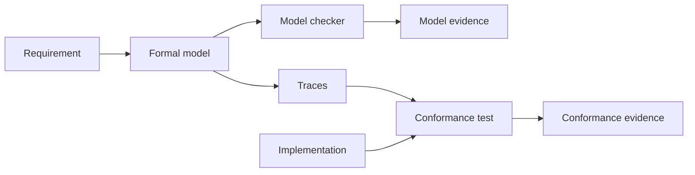

# Formal verification

## What is verified

The framework verifies:

- state-machine behavior;
- safety invariants;
- temporal properties;
- protocol rules;
- lifecycle and authorization constraints;
- conformance of an implementation to generated traces, where an adapter exists.

It does not verify:

- arbitrary implementation code;
- user interface quality;
- performance under all workloads;
- security against all adversaries;
- product intent.

## Model versus code



Model checking proves properties of the model. Conformance testing checks whether the implementation follows observed traces. Neither proves that the model matches the human's intent; that is why requirements remain readable and human-approved.

## Full-stack requirement

The default profile requires Quint and Apalache. A missing formal tool blocks approval for formal claims. Structural checks still run, but they do not substitute for model checking.

## Evidence

Each model-checking run records:

- property ID;
- module and source hash;
- command;
- tool versions;
- scope and depth;
- result;
- counterexample when failing.

Evidence is hashed in `spec.lock`. A changed model or property invalidates the evidence.

## Assumptions

Formal models make assumptions about:

- environment;
- message delivery;
- clock behavior;
- failure models;
- input domains;
- concurrency.

Assumptions are explicit spec elements. A verified property under an unstated assumption is not verified.

## Counterexamples

A counterexample is the most useful output of a failed check. The workflow is:

1. Read the trace.
2. Determine whether the model or the requirement is wrong.
3. File a requirement change or a model fix.
4. Re-run the checker.
5. Human reviews the corrected meaning.

Do not weaken a property solely to make the checker pass. If the property was wrong, record why.

## LLM reliability

LLMs can draft formal models, but model checking is the gate. A 2026 baseline found low semantic pass rates for LLM-generated TLA+ specifications across many models; specialized repair loops improve results but do not eliminate the need for human review.

Required loop:

```text
draft → typecheck → model check → inspect counterexample → repair → repeat
```

Additional tools such as a specialized model or agent can be used, but no output is accepted without a passing checker.

## Conformance

- **Rust**: Quint Connect.
- **Other languages**: generic trace replay adapter, generated tests, or manual execution with recorded evidence.
- **No adapter**: conformance is marked unverified and requires a waiver.

Model evidence and conformance evidence are separate. The audit bundle shows both.

## Preflight is not conformance

Compiler and build preflight belongs to the implementation layer, not to formal verification. A successful typecheck or build proves that the implementation is well-formed for a specific toolchain. It does not prove that an implementation follows a Quint trace, satisfies a requirement, or preserves a temporal property.

Preflight evidence and formal evidence stay separate in the audit bundle.

## Tool selection

| Problem | Default | Alternative |
|---|---|---|
| Temporal behavior | Quint | TLA+ |
| Relational invariants | Quint or Alloy | Alloy |
| Rust code proofs | none by default | Verus, Kani, Prusti |
| Dafny code | none by default | Dafny |
| Protocol state machines | Quint | TLA+ |

## Scope limits

- Bounded model checking is not an unbounded proof.
- Conformance traces cover sampled behavior.
- Non-Rust adapters are later work.
- Code proofs are opt-in and language-specific.
- Formal verification cannot validate a requirement that is missing.

## Acceptance criteria

A formal claim is accepted only when:

1. The requirement is approved and readable.
2. The property is linked by ID.
3. Type checking passes.
4. Model checking passes.
5. Evidence is stored and hashed.
6. Conformance is tested or explicitly waived.
7. A human has reviewed the property meaning.
