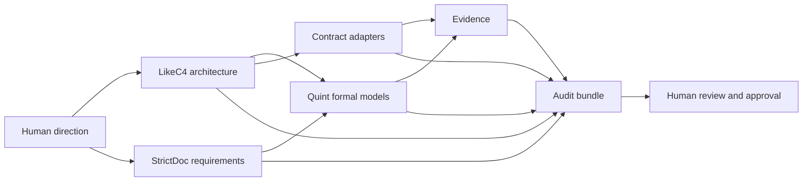

# Landscape

## Summary

No existing tool covers readable architecture, structured requirements, formal behavior, typed contracts, deterministic audit output, and human approval. The framework composes tools that are individually mature.

## Tool comparison

| Tool | Category | What it does well | What it does not do |
|---|---|---|---|
| GitHub Spec Kit | Agent workflow | Spec → plan → tasks workflow; familiar templates | Prose artifacts; no architecture graph or formal verification |
| Kiro | Agent IDE workflow | Requirements and design documents; task planning | Prose-first; IDE-bound; no formal checks |
| OpenSpec | Agent workflow | Spec deltas and change tracking for agents | Markdown-centric; no typed graph or verifier |
| SpecD | Agent workflow | Deterministic spec merging, validation, deltas, multi-repo | No architecture validation or formal behavior |
| BMAD-style agent methods | Process | Role separation and staged delivery | Process, not a verifiable artifact model |
| LikeC4 | Architecture as code | DSL, custom element kinds, views, validation, MCP server, agent skills | No requirements management or formal behavior |
| Structurizr | Architecture as code | Strict C4 model, DSL, MCP, inspection | No requirements or formal behavior |
| SysML v2 | Systems modeling | Parts, ports, connections, requirements, state machines, textual notation, traceability | Heavy tooling; no built-in model checker; weak agent/MCP ecosystem |
| StrictDoc | Requirements and audit | SDoc/Markdown, strict grammar, traceability, coverage, diff/changelog, HTML/PDF, ReqIF | No architecture or formal behavior |
| Doorstop | Requirements | YAML/Markdown items, links, review fingerprints, HTML publish | Weaker audit-grade PDF and diff than StrictDoc |
| OpenFastTrace | Requirement tracing | Requirement-to-code/test tags, deep coverage, HTML/XML reports; optional code tracing | Tracing only; not architecture or formal behavior |
| Quint | Formal behavior | Executable specs, types, simulator, Apalache/TLC, LLM kit, model-based testing | No architecture or requirements management |
| TLA+ | Formal behavior | Mature model checking and proofs; MCP and agent skills in 2026 tooling | Harder syntax; lower LLM success without a repair loop |
| Alloy | Formal structure | Relational constraints, access-control and data invariants | Not a full temporal behavior workflow |
| Dafny / Verus / Kani / Prusti | Code verification | Machine-checked code contracts and proofs | Language-specific; not a system specification workflow |

## Why not one tool

- **Agent workflow tools** optimize the sequence of prompts and artifacts. They do not make the artifacts typed or independently verifiable.
- **Architecture-as-code tools** validate structure but do not own requirements or behavior.
- **Requirements tools** provide readable traceability but cannot prove behavior.
- **Formal tools** prove behavior but do not manage architecture, contracts, or human approval.
- **Standards-based modeling tools** (SysML v2) cover more of the model, but the toolchain is heavy and still needs an external formal verifier.

A single-tool solution would have to rebuild parsers, renderers, model checkers, requirements traceability, and document export. That is more risk than value.

## Chosen composition

- LikeC4 is the architecture source and the visual review surface.
- StrictDoc is the requirements and audit backbone.
- Quint is the formal behavior source.
- Contract adapters cover language APIs, data formats, CLIs, and wire protocols.
- A small CLI checks cross-layer integrity, coverage, approvals, and renders the bundle.

## What changed in 2025–2026

- Architecture-as-code tools added MCP servers and agent skills, making the architecture graph directly queryable by agents.
- Quint shipped an LLM kit and conformance testing for Rust, making formal specs practical in an agent loop.
- StrictDoc continued to mature as an audit-oriented, text-based requirements tool with PDF and ReqIF output.
- LLM-generated formal specifications remain unreliable without a model-checking feedback loop. The framework therefore treats the checker, not the model, as the gate.

## Open landscape questions

- Whether SysML v2 becomes ergonomic enough for software-only projects.
- Whether StrictDoc's experimental source-code traceability is sufficient or OpenFastTrace should be the default code tracer.
- Whether conformance-trace replay can be generalized beyond Rust without excessive per-language work.
- Whether a unified MCP server for the whole spec graph is worth building.
