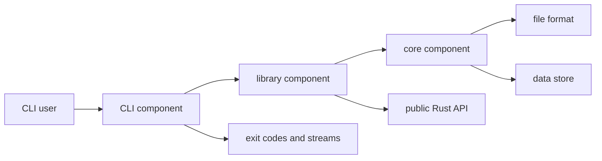

# Non-web projects

## Default assumption

The framework assumes boundaries are not HTTP endpoints. A project may have no network interface at all.

## Boundary types

| Type | Examples | Contract |
|---|---|---|
| Language API | Rust crate, TypeScript package, PHP library | public API surface |
| CLI | developer tool, batch processor | commands, flags, exit codes, streams |
| File format | config, archive, database file | JSON Schema, CUE, CDDL |
| IPC | Unix socket, message queue, shared memory | message schema and protocol |
| Wire | TCP/UDP protocol, RPC | Protobuf, CDDL, custom schema |
| Hardware | device register map, bus protocol | manual or SystemRDL/IP-XACT |
| Event | domain event, telemetry | schema and delivery semantics |

## Example: library + CLI + file format

Requirements cover:

- library API behavior;
- CLI output and exit behavior;
- file parsing and validation;
- error classes;
- compatibility promises.

Formal models cover:

- file state machine;
- partial writes and recovery;
- concurrent access assumptions;
- version migration rules.

Contracts cover:

- rustdoc public API and `cargo-semver-checks`;
- JSON Schema for the file format;
- CLI help and exit snapshots.

No OpenAPI document exists. The specification is still complete for its scope.

## Embedded and protocol projects

- Devices and buses are modeled as components and protocols.
- Timing and ordering assumptions are explicit invariants or assumptions.
- Register maps can be manual contracts in Phase 1.
- Protocol behavior is formalized in Quint.
- Conformance may require a simulator or hardware-in-the-loop adapter; until then, the evidence is marked manual and waived if accepted.

## Game and simulation projects

- Architecture maps systems, subsystems, and data stores.
- Requirements cover progression, save/load, inventory invariants, and state transitions.
- Formal models cover state machines and economy rules, not rendering or feel.
- Performance requirements carry metric, unit, threshold, and measurement method.

## What not to do

- Do not invent HTTP endpoints to fit an API tool.
- Do not force an IDL on an in-process library.
- Do not treat a CLI as an afterthought; it is often the primary contract.
- Do not claim file-format compatibility without schema evidence.
- Do not formalize subjective qualities; use measurable criteria or explicit waivers.
