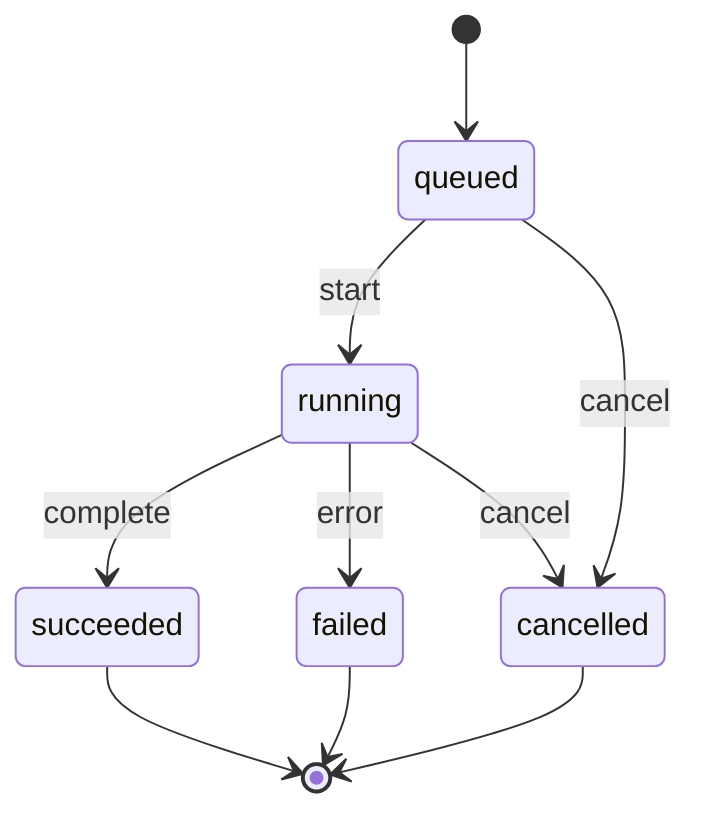

# Analysis jobs and snapshots

Status: implemented.

## Purpose

Analysis is incremental, repeatable, and recorded against a Git revision.
Snapshots make generated-spec evolution observable.

## Job lifecycle

## Progress

Progress uses SSE.

Events:

- `queued`;
- `phase_started`;
- `progress`;
- `finding`;
- `warning`;
- `completed`;
- `failed`;
- `cancelled`.

Progress is informational. Completion state is authoritative.

## Snapshot

A snapshot records:

- project;
- Git commit;
- dirty state;
- analyzer ID and version;
- schema version;
- rule version;
- prompt and model versions for AI outputs;
- input hashes;
- node, edge, flow, and finding counts;
- generation time as metadata.

Snapshot identity is deterministic for the same commit and versions. Creation
time is excluded from comparison.

## Incremental analysis

- hash files;
- reuse results for unchanged files;
- re-run dependency and call resolution for changed neighborhoods;
- re-run diagnostics affected by changed inputs;
- keep local finding annotations across runs;
- report removed and added files.

## Comparison

Compare two snapshots:

- added, removed, and changed elements;
- added, removed, and changed relationships;
- new, removed, and changed flows;
- new, removed, and changed findings;
- coverage changes;
- entry-point changes.

Comparison never modifies the older snapshot.

## Reproducibility

- pin analyzer, rules, prompts, and models;
- record versions in the snapshot;
- store input hashes;
- keep generated artifacts deterministic;
- show a warning when the current commit differs from the snapshot.

## Deletion and recovery

- `.spec/analysis.sqlite` is a cache and history store;
- deleting it is safe;
- re-analysis rebuilds derived data;
- local finding annotations can be exported under `.spec/` so deletion is not
  lossy for human review metadata.

## Security

- analysis is read-only;
- no repository code execution;
- registered roots only;
- no absolute paths in generated artifacts;
- secrets excluded from scanning and AI context;
- localhost-only workbench by default.
