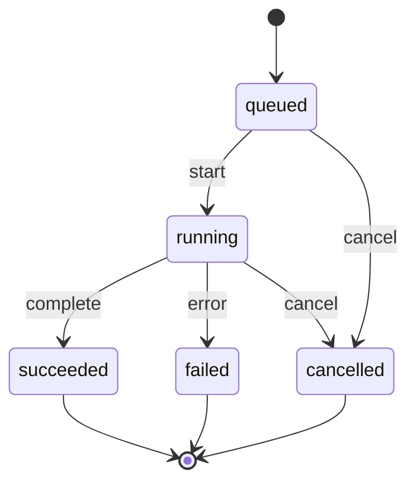

# Analysis jobs and snapshots

Status: planned.

## Purpose

Analysis is incremental, repeatable, and recorded against a Git revision.
Snapshots make architecture evolution observable.

## Job lifecycle



States:

- `queued`;
- `running`;
- `succeeded`;
- `failed`;
- `cancelled`.

Concurrency is bounded. Long analysis runs in the background. The workbench may
read the last successful snapshot while a new run is active.

## Progress

Progress uses SSE.

Events:

- `queued`;
- `phase_started`;
- `progress`;
- `finding`;
- `warning`;
- `completed`;
- `failed`;
- `cancelled`.

Event fields:

```json
{
  "job_id": "JOB-...",
  "phase": "typescript",
  "progress": 0.42,
  "message": "resolved 1200 of 2800 symbols",
  "timestamp": "2026-11-13T00:00:00Z"
}
```

Progress is informational. Completion state is authoritative.

## Snapshot

A snapshot records:

- project;
- Git commit;
- dirty state;
- analyzer ID and version;
- schema version;
- rule version;
- prompt and model versions for AI outputs;
- input hashes;
- node count, edge count, flow count, finding count;
- creation time as metadata.

Snapshot identity is deterministic for the same commit and versions. Creation
time is excluded from comparison.

## Incremental analysis

- hash files;
- reuse results for unchanged files;
- re-run dependency and call resolution for changed neighborhoods;
- re-run diagnostics affected by changed inputs;
- keep human annotations across runs;
- report removed and added files.

## Comparison

Compare two snapshots:

- added, removed, and changed elements;
- added, removed, and changed relationships;
- new and resolved flows;
- new, changed, and dismissed findings;
- changes in coverage;
- changes in entry points.

Comparison never modifies the older snapshot.

## Reproducibility

- pin analyzer, rules, and prompts;
- record versions in the snapshot;
- store input hashes;
- keep generated artifacts deterministic;
- make findings reproducible against their original snapshot;
- show a warning when the current commit differs from the snapshot.

## Deletion and recovery

- `.spec/analysis.sqlite` is a cache and history store;
- deleting it is safe;
- re-analysis rebuilds derived data;
- annotations should also be exportable to `spec/generated/` so deletion is not
  lossy for human decisions.

## Security

- analysis is read-only;
- no repository code execution;
- registered roots only;
- no absolute paths in generated artifacts;
- secrets excluded from scanning and AI context;
- localhost-only workbench by default.
