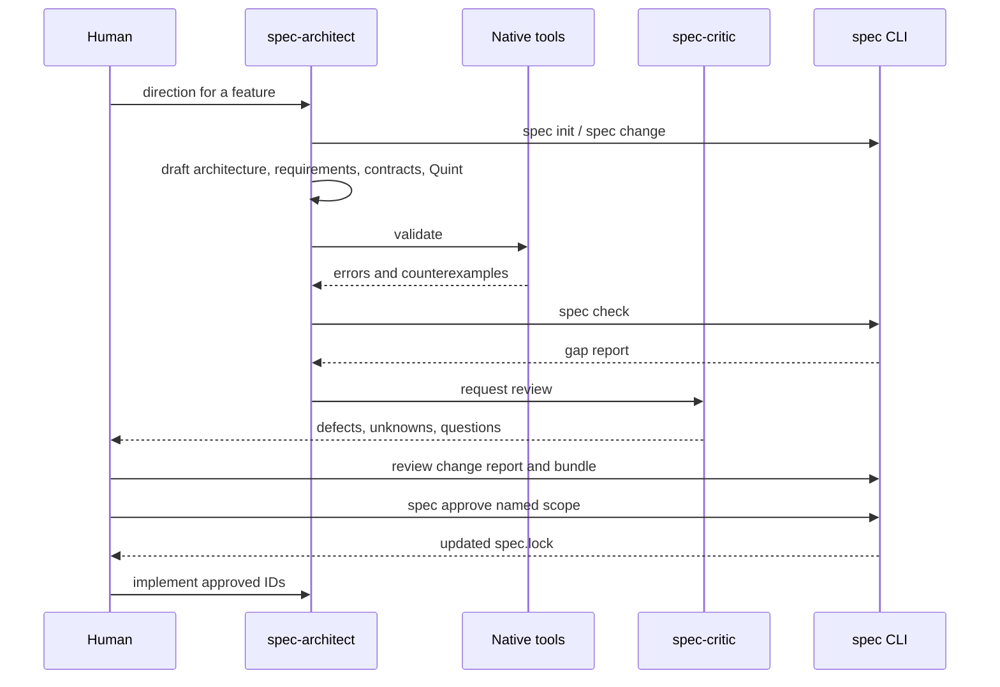

# Authoring workflow

> Status: partially implemented. `spec change` creates proposal branches,
> applies typed SDoc, architecture, and contract operations, and reports impact
> across requirements, architecture, formal sources, contracts, evidence, and
> approvals. `spec start` opens the scratch-mode entry. `spec approve --scope`
> resolves visible requirement titles to identity. The local workbench and the
> opencode plugin are implemented. `spec next` and the guided terminal sessions
> cover scratch drafting, mapping curation, and refactor operations without an
> approval path.

## Principle

The agent drafts. Deterministic tools validate. The human approves. Code follows the approved specification.

This is one loop with three starting states: scratch, mapping, and refactor.
See [use-case modes](use-cases.md).

Planning is interactive. The terminal, the [workbench](workbench.md), and the
[opencode plugin](opencode-plugin.md) operate on the same proposal. A static
report or bundle is an output, not the working surface.

On a TTY, `spec start`, `spec map --review`, `spec change`, and `spec refactor`
continue into guided sessions. `spec next` shows the current decisions and
checks. `--no-interactive`, `--json`, `--action`, and `--op` keep scripted
output unchanged.

Humans work with names, questions, and outcomes. Stable IDs, status values, and
diagnostic codes stay in sources and the audit bundle. See
[presentation and internal identity](../ux/presentation.md).

## Roles

| Role                 | Responsibility                                             |
| -------------------- | ---------------------------------------------------------- |
| Human                | Direction, answers, architecture review, approval          |
| spec-architect agent | Draft architecture, requirements, contracts, formal models |
| spec-critic agent    | Read-only review; files defects and unknowns               |
| Native tools         | Validate architecture, traceability, behavior, contracts   |
| spec CLI             | Link, gate, hash, bundle, report                           |

## End-to-end flow



## Steps

### 1. Direction

The human states the change in domain terms:

- goal and scope;
- affected systems;
- constraints;
- known decisions;
- explicit non-goals.

The agent records the direction as a `DEC-*` draft and asks only questions that affect normative behavior.

### 2. Proposal

`spec change <direction>` creates a proposal branch and a change report. The agent updates:

- LikeC4 model for new or changed components;
- capability model for new or changed abilities;
- StrictDoc records for requirements and acceptance criteria;
- semantic sources for vocabulary and constraints when the layer is active;
- verification plan for objectives and cases;
- Quint modules and properties for behavior;
- contract definitions and bindings for boundaries;
- unknowns for missing information.

No approved element is edited in place. An approved element that changes becomes `proposed` and loses its approval hash.

### 3. Validation

The agent runs:

```bash
spec check
```

This executes:

- structural checks;
- LikeC4 validation;
- capability coverage and hierarchy checks;
- StrictDoc validation and traceability;
- semantic validation and SHACL checks when active;
- verification plan coverage;
- Quint type checking and model checking;
- contract adapter and binding checks;
- cross-layer impact and coverage lint.

The agent repairs failures until the checks pass or a real unknown remains.

### 4. Review

The human reviews:

- the change report;
- affected architecture and capability views;
- changed requirements and acceptance criteria;
- ontology, concept, and semantic-contract changes;
- verification objectives, methods, and coverage;
- formal properties and counterexamples;
- contract compatibility and bindings;
- unknowns and waivers.

The agent may summarize, but the human reviews the generated bundle and diff, not an LLM narrative.

### 5. Approval

The human approves a named scope. Interactive approval resolves the identity
internally; scripted approval may pass IDs directly.

```bash
spec approve --scope "Session expiry"
spec approve REQ-AUTH-001 AC-AUTH-001
```

Named scopes resolve exact titles case-insensitively and expand a requirement
to its acceptance criteria. Ambiguous titles require a contextual choice.
Approval records content hashes and evidence hashes. Any later content change
invalidates the approval. The workbench and the agent cannot approve.

### 6. Implementation

The agent implements only approved IDs. Code annotations reference the IDs:

```rust
// @spec REQ-AUTH-001
fn reject_expired_token(...) { ... }
```

CI checks that:

- referenced IDs exist and are approved;
- implementation files are not linked to unapproved requirements;
- contract evidence still matches;
- formal properties still pass.

### 7. Verification

The agent runs conformance tests and stores evidence. The human does not accept "done" without a passing verification report.

## Feature slice

A typical first slice contains:

- one system boundary;
- one capability;
- one or two components;
- one interface or contract;
- two or three requirements;
- one acceptance criterion per requirement;
- one verification objective and case per method used;
- one Quint property when behavior is formalized;
- one evidence item per verification case.

Small slices expose friction early. Large slices hide gaps.

## Full-stack default

`spec init` writes the full profile. `spec doctor --fix` provisions tools. `spec check` reports missing capabilities for every active layer. An adapter is active when its sources or language are detected, or when it is explicitly required in config. Inactive adapters do not run and their tools are not required. The human does not need to choose which layers exist; they choose which changes to approve.

## Example

```bash
spec init --existing
spec doctor --fix
spec map --draft
spec change "add session expiry handling"
spec check
spec bundle
# human reviews audit bundle and change report
spec approve REQ-AUTH-001 AC-AUTH-001 CMP-AUTH PROP-AUTH-EXPIRY
```

## Failure handling

- Missing information: create `UNK-*`, do not guess.
- Contradiction: create a decision request, do not silently choose.
- Unverifiable requirement: create a waiver request, do not claim verification.
- Failing formal property: fix the model or the requirement; never suppress the checker.
- Expired waiver: reopen the requirement.
- Missing tool: run `spec doctor --fix`; do not bypass the check.
