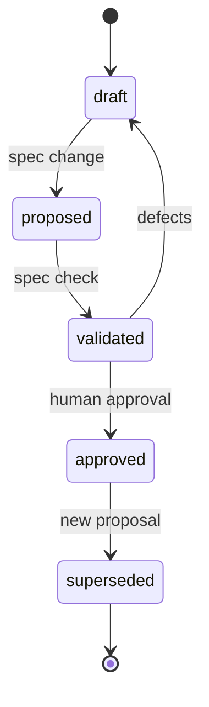

# Change management

## Principle

Every change is a proposal against an approved baseline. The change report explains impact before code changes.

## Proposal lifecycle



## Change report

`spec change` produces a report containing:

- changed element IDs and titles;
- added, modified, removed, deprecated elements;
- affected requirements and components;
- architecture diagram diffs;
- formal properties added or changed;
- contract compatibility changes;
- invalidated evidence;
- approvals that must be renewed;
- new unknowns and waivers;
- validation results.

Example:

```text
CHANGE auth-expiry
  MODIFIED  REQ-AUTH-004   add refresh failure behavior
  ADDED     PROP-AUTH-REFRESH   new liveness property
  MODIFIED  CMP-AUTH       add token-store dependency
  ADDED     CON-AUTH-REFRESH    refresh API
  INVALID   EVD-AUTH-004-001    requirement hash changed
  BLOCKED   1 missing formalization
```

## Impact analysis

The CLI walks links in both directions:

- requirement to component;
- component to interfaces and contracts;
- requirement to formal property;
- property to evidence;
- evidence to code and tests.

Any changed input invalidates downstream evidence. The report lists the affected chain.

## Approval invalidation

- Editing an approved element removes its approval hash.
- Editing evidence removes the evidence hash.
- Changing a contract invalidates compatibility evidence.
- Changing a formal property invalidates model-checking evidence.
- Changing a requirement invalidates acceptance evidence.

A human must re-approve the changed scope. Unchanged elements keep their approval.

## Waivers

A waiver is a change like any other:

- new waiver requires a human approver;
- waiver scope is explicit;
- waiver has an expiry;
- expired waivers block approval;
- removing a waiver invalidates dependent approvals.

## Deprecation

- Approved elements are never deleted.
- Deprecated elements remain in the bundle with status and replacement links.
- Evidence remains available for audit.
- Downstream links must be updated or explicitly waived.

## Drift findings

`spec map --check` and CI report:

- code elements not in the approved architecture;
- approved elements missing from code;
- contract surface changes;
- stale evidence;
- code annotations referencing unapproved or missing IDs.

Drift findings do not modify the spec. They create a proposal or a defect.

## Merge policy

- Proposal merges must include a change report.
- The approved baseline is updated only by `spec approve`.
- CI verifies `spec.lock` against current content.
- Generated artifacts are rebuilt, not merged.
- The audit bundle is attached to the release or change record.

## Rollback

- Reverting a commit restores sources.
- Approval hashes must be regenerated for the reverted state.
- Evidence must be regenerated.
- A rollback is not complete until the bundle reflects the restored state.
