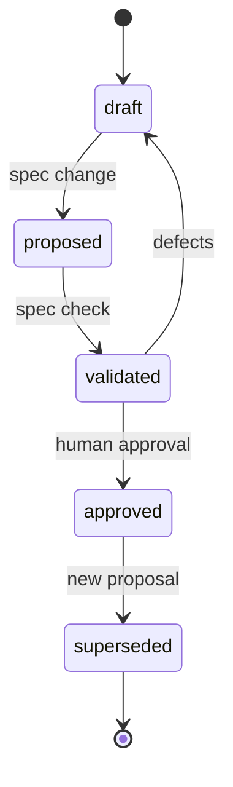

# Change management

> Status: partially implemented. `spec change` creates same-worktree proposal
> branches, applies typed SDoc operations `rename`, `deprecate`, `replace`,
> `split`, and `merge`, and reports impact over the current SDoc graph.
> `extract`, `move`, `change-contract`, `spec refactor`, and the workbench
> remain design.

## Principle

Every change is a proposal against an approved baseline. The change report explains impact before code changes.

`spec change` is the shared engine for all use-case modes. `spec refactor` is a
thin alias. Scratch and mapping proposals use the same engine with drafts only.
See [use-case modes](use-cases.md).

Proposals use one same-worktree Git branch. The branch records its base commit
and baseline. Git worktrees are deferred until concurrent proposals require
them.

The human-facing report uses names and outcomes first. Internal IDs, hashes, and
diagnostic codes appear in technical details and in the audit bundle. See
[presentation and internal identity](../ux/presentation.md).

## Proposal lifecycle



## Change report

`spec change` produces a report containing:

- changed element IDs and titles;
- added, modified, removed, deprecated elements;
- affected capabilities, requirements, and components;
- architecture diagram diffs;
- ontology, concept, and semantic-contract changes;
- verification objectives and cases added or changed;
- formal properties added or changed;
- contract bindings and compatibility changes;
- invalidated evidence;
- approvals that must be renewed;
- new unknowns and waivers;
- validation results.

Example:

```text
CHANGE auth-expiry
  MODIFIED  CAP-SESSION-MANAGEMENT  add refresh failure behavior
  MODIFIED  REQ-AUTH-004   add refresh failure behavior
  ADDED     VOBJ-AUTH-REFRESH   refresh verification objective
  ADDED     VER-AUTH-REFRESH    formal and test cases
  ADDED     PROP-AUTH-REFRESH   new liveness property
  MODIFIED  CMP-AUTH       add token-store dependency
  ADDED     CON-AUTH-REFRESH    refresh API
  MODIFIED  SCON-AUTH-TOKEN     add refresh shape
  INVALID   EVD-AUTH-004-001    requirement hash changed
  BLOCKED   1 missing verification case
```

The example above is the technical view. The default review surface says
“Session management changed”, “Refresh failure handling added”, and “Token store
dependency added”, then lists the affected checks and approvals. IDs and hashes
are available under technical details.

## Refactor operations

Refactoring uses typed operations, not free-form edits:

| Operation         | Meaning                                                        |
| ----------------- | -------------------------------------------------------------- |
| `rename`          | Change a title or label; IDs stay stable                       |
| `split`           | Create new elements and `replaces` links from one element      |
| `merge`           | Combine elements into a new element, deprecating the originals |
| `extract`         | Move a responsibility into a new component or capability       |
| `move`            | Change containment or ownership                                |
| `deprecate`       | Retire an element without deleting it                          |
| `replace`         | Introduce a replacement with explicit deprecation              |
| `change-contract` | Change a boundary and record compatibility impact              |

`rename`, `deprecate`, `replace`, `split`, and `merge` apply to SDoc records
today. `extract`, `move`, and `change-contract` remain design because they need
architecture and contract source writers.

The workbench simulates the before and after graph. The proposal cannot be
implemented until a human approves the changed scope.

## Impact analysis

The CLI walks links in both directions:

- capability to requirement and verification objective;
- requirement to component, contract, and verification case;
- component to interfaces and contracts;
- ontology to concept, semantic contract, requirement, and contract;
- requirement to formal property and verification case;
- property or case to evidence;
- evidence to code and tests.

Any changed input invalidates downstream evidence. The report lists the affected
chain.

Current implementation walks the SDoc requirement and acceptance graph in both
directions. Change seeds are typed operation targets and new records, plus
locked elements whose content hash or `STATUS: Approved` no longer matches the
current sources. The report lists changed and affected elements with names in
the default view, invalidated evidence, approvals to renew, and open questions.
Technical output and JSON keep IDs, distances, and traversal links. Evidence
hashing and regeneration remain pending.

The baseline is explicit: a PR merge-base, a named approved baseline, or `HEAD`
for pending local work. Without an explicit baseline, the impact report is
incomplete. Multi-repository impact analysis uses the recorded composition and
pins; it never fetches repositories during analysis. See
[workspace and branches](../architecture/workspace-and-branches.md).

## Approval invalidation

- Editing an approved element removes its approval hash.
- Editing evidence removes the evidence hash.
- Changing a capability invalidates derived requirement and coverage approval.
- Changing an ontology or concept invalidates linked semantic evidence.
- Changing a semantic contract invalidates SHACL evidence and dependent approvals.
- Changing a verification objective or case invalidates its execution evidence.
- Changing a contract invalidates compatibility evidence.
- Changing a formal property invalidates model-checking evidence.
- Changing a requirement invalidates acceptance and verification evidence.

A human must re-approve the changed scope. Unchanged elements keep their approval.

## Waivers

A waiver is a change like any other:

- new waiver requires a human approver;
- waiver scope is explicit;
- waiver has an expiry;
- expired waivers block approval;
- removing a waiver invalidates dependent approvals.

## Deprecation

- Approved elements are never deleted.
- Deprecated elements remain in the bundle with status and replacement links.
- Evidence remains available for audit.
- Downstream links must be updated or explicitly waived.

## Drift findings

`spec map --check` and CI report:

- code elements not in the approved architecture;
- approved elements missing from code;
- capabilities with no derived requirement;
- semantic terms with no usage or pinned source;
- verification cases with no evidence;
- contract surface changes;
- stale evidence;
- code annotations referencing unapproved or missing IDs.

Drift findings do not modify the spec. They create a proposal or a defect.

## Merge policy

- Proposal merges must include a change report.
- The approved baseline is updated only by `spec approve`.
- CI verifies `spec.lock` against current content.
- Generated artifacts are rebuilt, not merged.
- The audit bundle is attached to the release or change record.

## Rollback

- Reverting a commit restores sources.
- Approval hashes must be regenerated for the reverted state.
- Evidence must be regenerated.
- A rollback is not complete until the bundle reflects the restored state.
