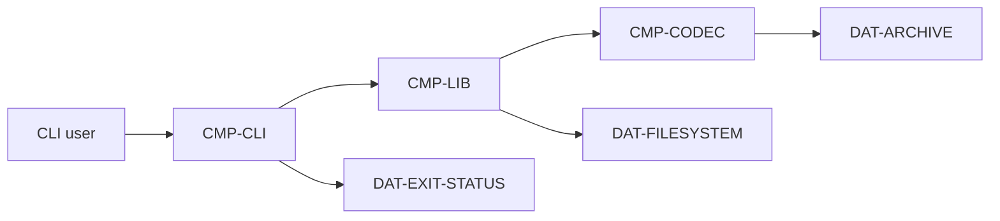

# Example: library + CLI + file format

This is an illustrative non-web project. It exists to show the shape of the framework, not a real implementation.

## System

`kvpack` is a local key-value archive format with:

- a Rust library (`kvpack`);
- a CLI (`kvpack`);
- a file format (`.kvp`);
- no network interface.

## Architecture



Components:

| ID | Responsibility | Owner |
|---|---|---|
| `CMP-CLI` | Parse commands and render results | cli |
| `CMP-LIB` | Public library operations | library |
| `CMP-CODEC` | Encode and decode `.kvp` files | format |

Data:

| ID | Meaning |
|---|---|
| `DAT-ARCHIVE` | Persisted `.kvp` file |
| `DAT-FILESYSTEM` | Atomic replacement of files |
| `DAT-EXIT-STATUS` | CLI exit code contract |

## Requirements

```text
[REQUIREMENT]
UID: REQ-FORMAT-001
TITLE: Reject truncated archives
STATUS: Proposed
STATEMENT: When a .kvp archive ends before its declared record count, the codec shall reject the archive with error TRUNCATED_ARCHIVE.
RATIONALE: Truncated files must not be partially applied.
ACCEPTANCE: AC-FORMAT-001
COMPONENT: CMP-CODEC
FORMAL: PROP-CODEC-TRUNCATION
EVIDENCE: EVD-FORMAT-001
PROVENANCE: human:joao@2026-11-10
OWNER: format
```

```text
[REQUIREMENT]
UID: REQ-CLI-001
TITLE: Atomic replacement failure is visible
STATUS: Proposed
STATEMENT: If the filesystem cannot atomically replace a target archive, then the CLI shall exit with status 3 and print a single error line to stderr.
RATIONALE: Scripts must be able to detect partial writes.
ACCEPTANCE: AC-CLI-001
COMPONENT: CMP-CLI
FORMAL: PROP-FS-ATOMICITY
EVIDENCE: EVD-CLI-001
PROVENANCE: human:joao@2026-11-10
OWNER: cli
```

## Contracts

### Rust public API

Source: rustdoc JSON and `cargo public-api`.

```text
CON-API-001
kind: rust-public-api
compatibility: semver
owner: library
package: kvpack
```

Compatibility evidence: `cargo-semver-checks` report.

### File format

Source: JSON Schema for the decoded header and record metadata.

```text
CON-FORMAT-001
kind: json-schema
compatibility: full
owner: format
schema: spec/contracts/kvp-header.schema.json
```

### CLI

Source: help and exit snapshots.

```text
CON-CLI-001
kind: cli
compatibility: backward
owner: cli
commands: [pack, unpack, inspect]
```

## Formal model

`MOD-CODEC` covers the archive state machine:

- empty;
- reading header;
- reading records;
- complete;
- truncated;
- corrupt;
- rejected.

`PROP-CODEC-TRUNCATION`: no state with fewer records than declared can reach `complete`.

`MOD-FS` covers atomic replacement:

- write temporary file;
- fsync;
- rename;
- failure injection;
- observable CLI outcome.

`PROP-FS-ATOMICITY`: a failed rename never leaves the target partially written.

## Verification

| Evidence | Source | Result |
|---|---|---|
| `EVD-FORMAT-001` | Quint + Apalache | pass |
| `EVD-CLI-001` | Quint + Apalache + CLI conformance | pass |
| `EVD-API-001` | cargo-semver-checks | compatible |
| `EVD-CON-FORMAT-001` | JSON Schema validation | pass |

## Audit bundle excerpt

```text
Scope
  Covered: archive format, library API, CLI exit behavior
  Not covered: performance on network filesystems

Requirements
  REQ-FORMAT-001  approved  formalized  PROP-CODEC-TRUNCATION
  REQ-CLI-001     approved  formalized  PROP-FS-ATOMICITY

Unknowns
  UNK-FS-002  behavior on filesystems without atomic rename  blocking: false

Waivers
  none

Approval
  approved by joao at 2026-11-10T12:00:00Z
  spec.lock hash: sha256:...
```

## What this example demonstrates

- Architecture without HTTP.
- Requirements with formal links.
- Contracts from a language API, a file schema, and CLI behavior.
- Model checking plus conformance evidence.
- A readable audit bundle backed by hashes.
- An explicit unknown instead of an invented guarantee.
